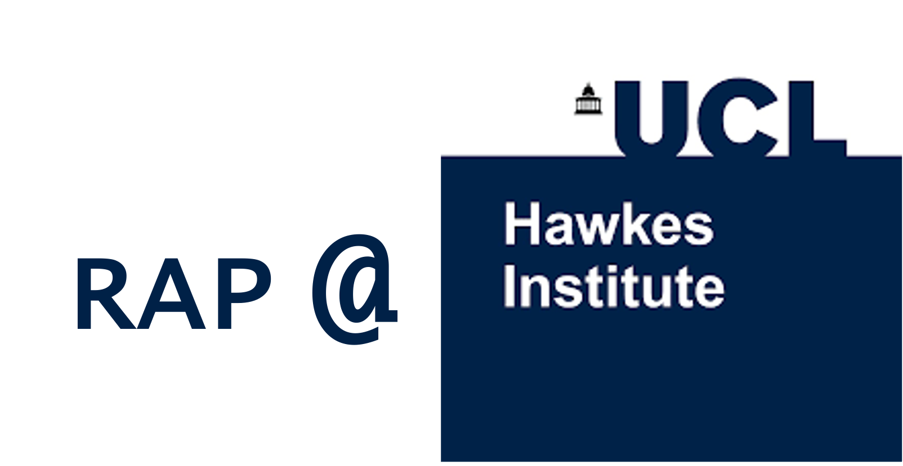

# RAP @ Hawkes

<!--  -->

This site contains resources and materials for the Reproducible Analytical Pipelines (RAP) workshop series at the UCL Hawkes Institute. This series aims to promote good software engineering practices to enable collaboration between researchers across the Institute.

## Schedule (2026/27)
Our second series of workshops will run over the 2026-27 academic year. The schedule will be announced soon - keep an eye on the [2026/27 series](workshops/2026-2027/index.md) page for updates.

## Previous series
- [2025/26 series](workshops/2025-2026/index.md): our first series of 8 hybrid workshops, covering Python best practices, cluster computing, GitHub, packaging, Docker, the software lifecycle and RAP in medical imaging research.

Slides, materials and recordings for each session are provided in the [workshops](workshops/index.md) pages, organised by academic year. If you have any problems accessing these please contact [Sophie](mailto:sophie.a.martin@ucl.ac.uk).

---

## Community Tooling Guide (coming soon!)
We will also be creating a RAP @ Hawkes community tooling [guide](tool_guide.md) to highlight our experience using common medical imaging and software tools with a traffic light system! Please do get in touch if you have any that you would like to share.

---

## Resources

Helpful external resources mentioned throughout the series will be added to the [resources](resources/useful_links.md) page. We have also compiled a specific list for [VS code extensions](resources/vscode_extensions.md) used frequently within the medical imaging community.

---

If you have any suggestions or ideas on how we can improve this site, let us know!
